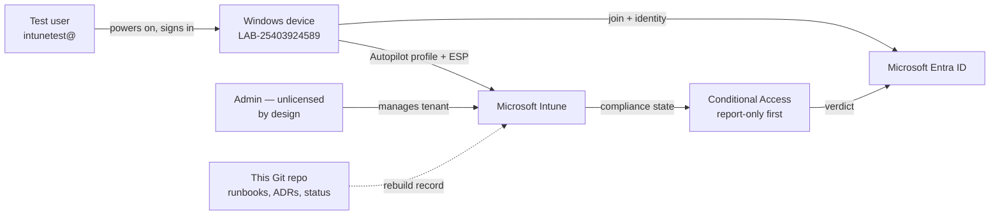

# Architecture — dex-intune-autopilot-lab

Cloud-managed endpoint: there is no site server and no VPN in this design. That is the point — the modern replacement for MECM-on-LAN is management over the public internet, bound by identity and compliance.

## Components
| Component | Where it runs | Notes |
|---|---|---|
| Tenant "Digitech Explorer Canada" | Microsoft 365 cloud | 1 paid Business Premium seat, held by `intunetest@` |
| Test device (VM) | Homelab host | Autopilot-registered; naming template `LAB-%SERIAL%` |
| Android device (Redmi) | Personal device | MAM app protection; selective wipe requested Oct 31 |
| This repository | Git (local now, GitHub on publish) | Documentation/organisation layer — not the tenant itself |

## Network path
Device reaches Intune/Entra service endpoints over the internet. No inbound ports, no site VPN operated. Stated plainly because "no VPN" is a design decision here, not an omission.

## Environments
| Env | Purpose |
|---|---|
| Lab tenant (only) | Build, break, reset — all exercises run here |
| Production | None. No real employer/client tenant is touched by this lab |
